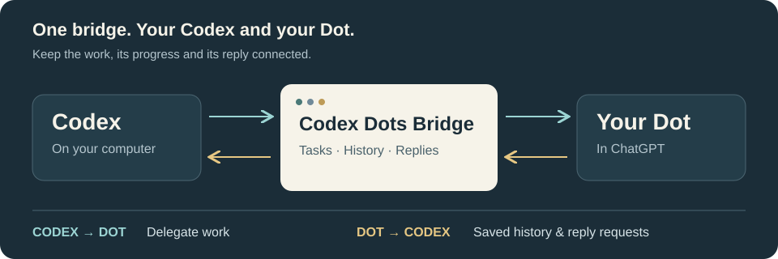
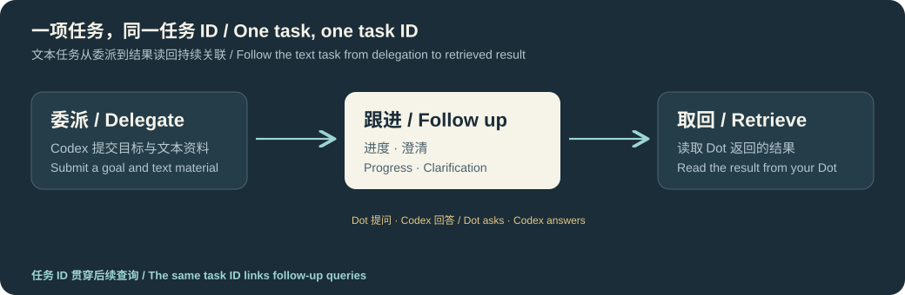
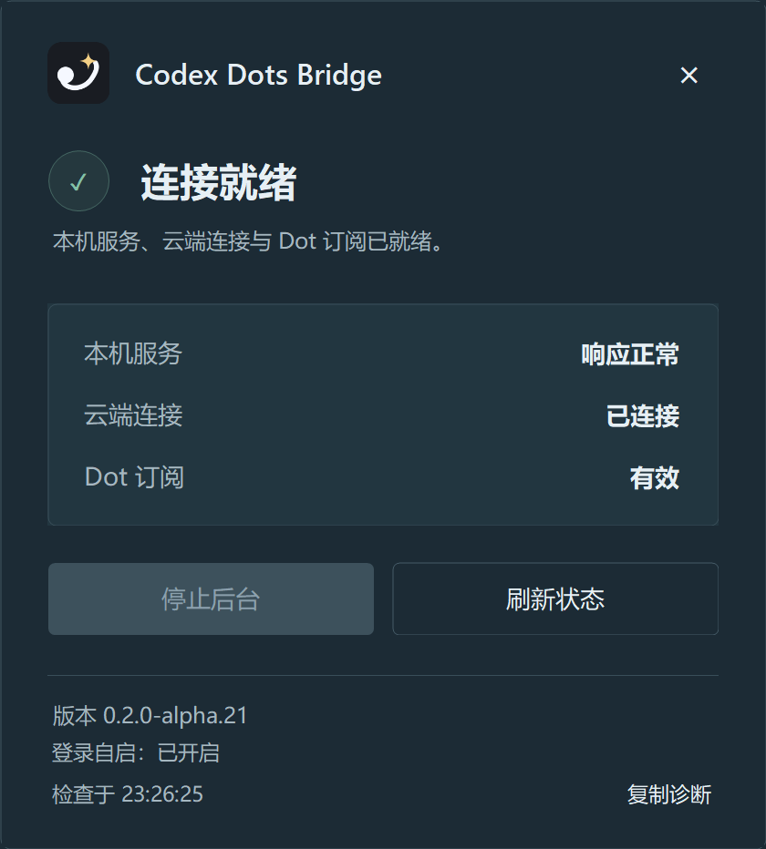
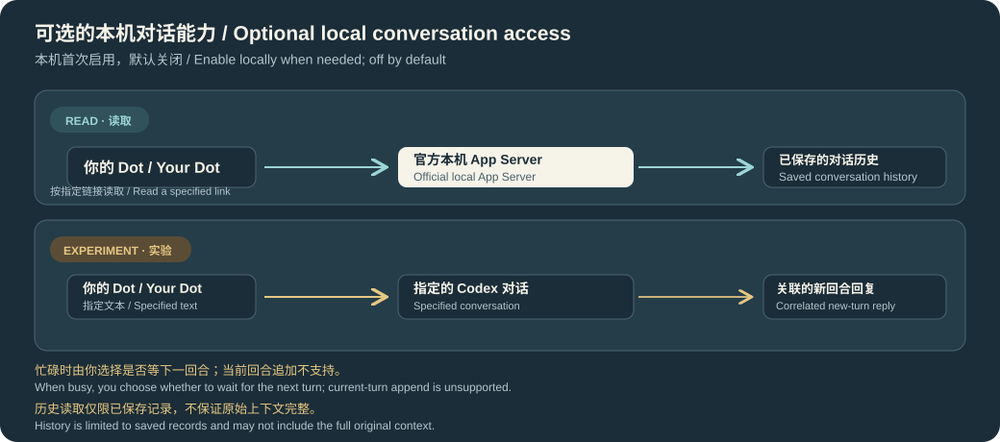

<p align="center">
  
</p>

<h1 align="center">Codex Dots Bridge</h1>

<p align="center">Hand work to your Dot, follow it in Codex, and retrieve the result.</p>

<p align="center">
  <a href="README.md">简体中文</a> · 0.3.0-alpha.2 pre-release · Windows x64 · <a href="LICENSE">MIT</a>
</p>

<p align="center">
  <a href="https://github.com/shilefumaoqu/codex-dots-bridge/releases/download/v0.3.0-alpha.2/Codex-Dots-Bridge-0.3.0-alpha.2-Setup.exe"><strong>Download the alpha.2 Windows installer</strong></a>
</p>

<p align="center">
  <a href="https://github.com/shilefumaoqu/codex-dots-bridge/releases/tag/v0.3.0-alpha.2">Windows ZIP, SHA256 files and full release notes</a>
</p>

> **Current version: 0.3.0-alpha.2, an experimental pre-release.** This release fixes the Windows reboot-recovery rejection for schema 2 data directories and adds real Windows recovery regressions. Alpha 0.2.0-alpha.32 cannot open migrated databases; follow the [migration and acceptance notes](ACCEPTANCE.md). Events accepted with HTTP 200 but never claimed, extended live chains and 72-hour stability remain separately tracked; a ready service does not prove a message round trip.

Codex Dots Bridge connects Codex to your existing Dot. Delegate a text task, then use the same task ID to follow progress, answer questions, add requirements and retrieve the result.

<p align="center">
  
</p>

## What the plugin does

| In Codex | Your Dot can | How the result follows through |
| --- | --- | --- |
| Submit a task and keep its ID | Receive the goal and text material | Check it later under the same task ID |
| Check progress, wait or answer a question | Report status or request clarification | Continue the original task |
| Add requirements or ask a follow-up | Work from the saved update | Keep a follow-up linked to its parent |
| Read results, cancel or resume a query | Save task results and stop status | Check execution, retrieval and acceptance separately |

<p align="center">
  
</p>

A task moves from delegation to progress updates. Answer your Dot's questions on the same task, then retrieve its result by the original task ID.

You can also choose to let your Dot read the stored history of a local Codex conversation you specify, or ask that conversation to process text and retrieve its correlated turn reply. Local conversation access is optional and defaults to off. Enable `read` or `read-send` once on this computer; individual conversations do not need registration.

## Get started

**You need:** Windows 10/11 x64, your own Codex and Dot, and the account permissions for your OpenAI account, Secure MCP Tunnel, ChatGPT workspace private plugin and MCP Events. Tunnel requires a dedicated runtime key; a Codex subscription does not grant Tunnel permissions. This project does not call a model API or provide a free, no-login Tunnel.

1. Download and run the Setup above. It includes Node; you do not need to install Node or npm separately. The installer is unsigned, so Windows SmartScreen or organization policy may warn or block it. A SHA256 checksum is not a publisher signature.
2. Open **Codex Dots Bridge → First connection and maintenance** from Start. Follow the [first-connection guide](docs/首次连接.md) to connect your own official Tunnel, private plugin and Dot. Leave the connection `pending` until account authorization, runtime key and subscription are ready.
3. Enable the Bridge plugin in a new Codex conversation and call `dots_status` to inspect the actual connection state.
4. Submit a harmless text task, keep its `task_id`, then use that ID to check progress, answer questions and retrieve the result.

### Windows tray

<p align="center">
  
</p>

The alpha.21 program rendered this image with a synthetic status; “Connection ready” does not mean a specific message succeeded. Left-click to open status. Right-click to toggle start-at-login; closing the tray leaves the backend running.

This source candidate adds [subscription checks and a recovery entry](docs/托盘订阅检查.md): expiry display, an amber warning near expiry, and one local notification for a confirmed outage. A click rechecks the current instance and can open the saved original rule. It never resends tasks or treats opening the rule as a successful renewal.

For your first task, ask Codex:

> Give the text below to my Dot, organize it into three bullet points, and tell me the task ID once submitted.

Then query the original task and retrieve its result. Tunnel readiness, an accepted event subscription or a queued task does not mean that the Dot has completed and returned a result.

## Optional: connect a local Codex conversation

Local conversation reading and sending are separate optional capabilities and default to `off`. After enabling `read` or `read-send` once, you do not need to register conversations individually. You still specify the conversation and content for each operation.

<p align="center">
  
</p>

Reading uses the official local App Server to page through saved history. Sending remains experimental and only retrieves the correlated reply from the specified conversation's new turn.

- **Read example:** “Read the stored history at this Codex conversation link and summarize the confirmed requirements.”
- **Send example:** “Send `17 × 19` to this Codex conversation and retrieve its reply from that turn.”

Reading all stored history pages does not guarantee complete original model context or recover material removed during compaction. A new send is rejected before persistence while another send owns that target. A next-turn choice requires an exact busy turn and owner; adding to the current turn is unsupported. After a confirmed send, background retrieval can read the exact reply under the original request for up to 24 hours. Missing evidence remains unknown; there is no resend or automatic posting to another chat.

## Current status and experimental boundaries

Candidate validation uses isolated temporary databases for logic, migration and synthetic performance. Windows artifacts, cross-version installation, at least 30 real round trips per chain and a 72-hour stability run remain separate acceptance requirements. Simple chat supports a reliable single text round trip without promising native conversation continuity. Pickup delay is an observation, not task completion. Historical evidence remains in the [changelog](CHANGELOG.md) and does not validate this candidate.

The alpha is designed for one user, one Windows computer and one existing Dot, with default concurrency of 1. It is intended for testers willing to configure it and report issues; it is not a claim of compatibility with every account, device policy or unattended long-running setup.

## Guides

- [Quick start](docs/快速开始.md) · [First connection and Tunnel setup](docs/首次连接.md)
- [Task and tool contract](docs/任务与工具契约.md) · [Dot execution guide](docs/Dot执行说明.md)
- [Maintenance and troubleshooting](docs/维护与故障排查.md) · [Compatibility and known limits](docs/兼容性与已知限制.md)
- [Releases and upgrades](docs/发布与升级.md) · [Alpha.21 installation and recovery acceptance](docs/alpha21启动恢复验收.md) · [Security](SECURITY.md)

## Build from source

Maintainers can run these commands in Windows PowerShell:

```powershell
.\scripts\bootstrap.ps1
.\scripts\dev.ps1 install
.\scripts\dev.ps1 build
.\scripts\dev.ps1 test
.\scripts\package.ps1 -IncludeTunnel
```

Builds require Node/npm and access to the official Tunnel download source. A local build or test does not publish a GitHub Release. See the [contributing guide](CONTRIBUTING.md) and [third-party notices](THIRD_PARTY_NOTICES.md).

---

This project is licensed under the [MIT License](LICENSE).

## Codex cloud development

Connect this repository with Node 24, then run `npm ci`, `npm run typecheck` and `npm run build`. Linux cloud checks do not validate the Windows installer, tray, desktop IPC or live Dot channel. Do not upload personal runtime keys, databases or local configurations. Publishing the repository and republishing a Codex environment are separate operations; existing cloud tasks retain their own state.
